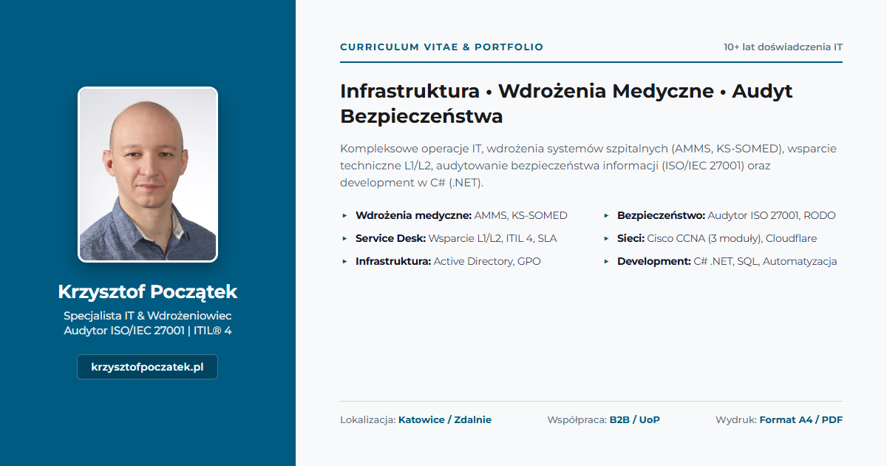

# Krzysztof Początek — Interaktywne CV & Portfolio IT

<p align="center">
  
</p>

<p align="center">
  <strong>Oficjalne, produkcyjne portfolio i interaktywne CV klasy Enterprise o zerowej liczbie zależności zewnętrznych.</strong><br>
  Specjalista ds. Wdrożeń AMMS / KS-SOMED • Audytor Wewnętrzny ISO/IEC 27001:2023 • ITIL® 4 Foundation • Cisco CCNA.
</p>

<p align="center">
  <a href="https://github.com/TwojaStronaWWW/Moje-CV/actions/workflows/deploy.yml"></a>
  
  
  
  
  
</p>

<p align="center">
  <a href="https://krzysztofpoczatek.pl" target="_blank">
    
  </a>
  <a href="https://krzysztofpoczatek.pl/Krzysztof_Poczatek_CV.pdf" target="_blank">
    
  </a>
</p>

---

## 📸 Podgląd Wizualny

<p align="center">
  
</p>

---

## 🎯 Czym jest projekt Moje-CV?

**Moje-CV** to interaktywne portfolio oraz oficjalne CV **Krzysztofa Początka**, zaprojektowane i wdrożone z myślą o najwyższych standardach inżynierskich branży IT. Łączy natychmiastową czytelność rekruterską (test pierwszych 6 sekund ATS) z bezkompromisową architekturą techniczną wzorowaną na ekosystemie produkcyjnym **Gal Anonim**.

> 🔒 **Filozofia Zero-Dependency & Pure Performance:**  
> Strona została zbudowana w 100% z czystego, semantycznego kodu (HTML5, Vanilla CSS3, ES6+ modules) bez żadnych ociężałych frameworków (brak Reacta, Vue czy TailwindCSS). Wszelkie testy, generowanie PDF oraz audyty a11y opierają się na natywnych narzędziach systemowych.

---

## ✨ Kluczowe Możliwości i Moduły

### 📄 Format Prezentacyjny i Druk A4
| Moduł / Widok | Technologia | Specyfikacja i Gwarancje |
| :--- | :--- | :--- |
| **Wersja Web (Interaktywna)** | Semantic HTML5 & CSS Grid/Flexbox | Pełna responsywność (Mobile / Desktop / 4K), obsługa a11y, Dark/Light Mode Tokens. |
| **Wersja Druk / PDF (A4)** | `assets/css/print.css` (`@page`) | Precyzyjne łamanie stron (`.page-break-before`), marginesy 10mm, zero urwanych wpisów doświadczenia. |
| **Kompilator PDF (Headless)** | `scripts/generate-pdf.js` (Chromium) | Automatyczny eksport do oficjalnego PDF `Krzysztof_Poczatek_CV.pdf` w potoku GitHub Actions. |
| **Optymalizacja ATS & SEO** | Open Graph, Twitter Cards, Schema.org | Twardy słownik kompetencji IT, semantyczna struktura JSON-LD dla encji `Person`. |

### 🧠 Kluczowe Kompetencje i Ramy Certyfikacyjne
* **Systemy Medyczne i Service Desk:** AMMS (Asseco), KS-SOMED (Kamsoft), osTicket (własne wdrożenie hd.twojastronawww.pl), Jira Service Management, Active Directory, SLA/ITIL.
* **Bezpieczeństwo i Zarządzanie:** Certyfikowany Audytor Wewnętrzny **ISO/IEC 27001:2023**, **ITIL® 4 Foundation**.
* **Sieci i Infrastruktura:** Cisco Networking Academy (cykl CCNA: ITN, SRWE, ENSA; przygotowanie do 200-301 CCNA), LAN/WLAN, VLAN, Routing, Cloudflare.
* **Development i Bezpieczeństwo Danych:** C# .NET 10 (twórca aplikacji desktopowej **Gal Anonim** do anonimizacji RODO), PHP 8, Vanilla JS, SQL (100% certyfikat IEES), CI/CD.

---

## 🏛️ Architektura i Potok CI/CD

```plaintext
Moje-CV/
├── .github/
│   ├── dependabot.yml              # Comiesięczny nadzór nad bezpieczeństwem akcji
│   ├── pull_request_template.md    # Checklista jakościowa dla Pull Requestów
│   ├── ISSUE_TEMPLATE/             # Szablony zgłoszeń (bug_report, task, config)
│   └── workflows/
│       └── deploy.yml              # Trójstopniowy potok CI/CD (Testy -> PDF & Audit -> Deploy)
├── .githooks/
│   ├── pre-commit                  # Blokada commitów przy niezaliczonych testach lub wycieku sekretów
│   └── commit-msg                  # Walidator Conventional Commits
├── assets/
│   ├── css/
│   │   ├── main.css                # Style ekranowe (zmienne CSS, typografia, układ)
│   │   └── print.css               # Dedykowany arkusz wydruku formatu A4
│   ├── js/
│   │   └── main.js                 # Logika interakcji UI (ARIA, Escape focus trap)
│   └── images/                     # Zoptymalizowane grafiki (photo.jpg, og-preview.png, favicon.svg)
├── scripts/
│   ├── generate-pdf.js             # Skrypt kompilacji PDF przez Headless Chromium
│   └── serve.js                    # Lokalny bezbiblioteczny serwer HTTP z ochroną Directory Traversal
├── tests/
│   ├── helpers/mock-dom.js         # Lekkie środowisko przeglądarki bez ociężałego jsdom
│   └── unit/                       # Zestaw 77 testów jednostkowych (node:test)
├── .editorconfig & .gitattributes  # Spójność kodowania UTF-8 i końców linii LF
├── index.html                      # Główny semantyczny dokument HTML5 (WCAG 2.1)
├── site.webmanifest                # Manifest PWA zgodny ze standardem _site-template
├── SECURITY.md                     # Polityka bezpieczeństwa zgodna z ISO/IEC 27001
├── robots.txt & sitemap.xml        # Kompletna mapa i indeksowanie SEO
└── package.json                    # Konfiguracja skryptów jakościowych npm
```

---

## 🛡️ Brama Jakości & Testy Jednostkowe (Quality Gate)

Wszystkie testy działają w oparciu o natywny silnik `node:test` i asercje `node:assert/strict` w Node.js (czas wykonania: **< 200 ms** dla czystych testów jednostkowych):

| Plik testowy | Zakres Weryfikacji |
| :--- | :--- |
| `tests/unit/main.test.js` | Logika UI, obsługa klawisza Escape, reset menu przy zmianie szerokości okna (> 900px), idempotentność i focus management. |
| `tests/unit/html-integrity.test.js` | Semantyka HTML5, dokładnie jeden nagłówek `<h1>`, Asset Integrity Check, `rel="noopener"`, manifest PWA, Open Graph, Schema.org JSON-LD. |
| `tests/unit/css-integrity.test.js` | Integralność reguł CSS, zbalansowanie nawiasów, spójność tokenów `:root`. |
| `tests/unit/print-css.test.js` | Poprawność formatu A4, `print-color-adjust: exact`, klasy `.page-break-before`. |
| `tests/unit/pdf-generator.test.js` | Wykrywanie silnika Chromium (Edge/Chrome) oraz kompilacja pliku PDF w izolowanym profilu. |
| `tests/unit/repo-hygiene.test.js` | Higiena repozytorium wzorowana na Gal Anonim i `_site-template` (`pre-commit`, `commit-msg`, `.gitattributes`, `SECURITY.md`, Directory Traversal w `serve.js`, Dependabot). |

---

## 💻 Komendy Deweloperskie

```bash
# 1. Uruchomienie wszystkich testów jednostkowych
npm test

# 2. Pełny raport pokrycia kodu (Code Coverage)
npm run test:coverage

# 3. Kompilacja oficjalnego pliku PDF z zachowaniem układu A4
npm run build:pdf

# 4. Pełna brama jakościowa (składnia JS + testy)
npm run check

# 5. Aktywacja lokalnych hooków gita
npm run prepare
```

---

## 🚀 Trójstopniowy Pipeline Wdrożeniowy (.github/workflows/deploy.yml)

Potok uruchamia się na każdym pushu do gałęzi `main`:
1. **Krok 1 (Quality Gate):** Weryfikacja składni JavaScript (`main.js`, `serve.js`, `generate-pdf.js`), uruchomienie 77 testów jednostkowych, analiza pokrycia.
2. **Krok 2 (Budowa PDF & Lighthouse):** Uruchomienie Headless Chromium, wygenerowanie pliku `Krzysztof_Poczatek_CV.pdf`, upload artefaktu do GitHub Releases oraz audyt a11y i SEO przez Lighthouse CI.
3. **Krok 3 (Wdrożenie SFTP & Cloudflare Purge):** Bezpieczny transfer plików HTML, PWA i PDF na hosting serwera LH pod domenę **`krzysztofpoczatek.pl`** oraz opcjonalne czyszczenie cache Cloudflare CDN.

---

## 👥 Autor i Kontakt

* **Kandydat / Właściciel:** Krzysztof Początek
* **Strona domowa:** [krzysztofpoczatek.pl](https://krzysztofpoczatek.pl)
* **Organizacja firmowa:** [TwojaStronaWWW](https://github.com/TwojaStronaWWW)
* **Prawa autorskie:** &copy; 2026 Krzysztof Początek. All rights reserved.
